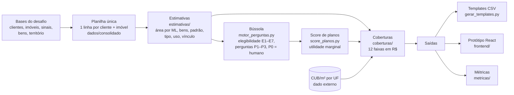

# Time Vector · Seguro Residencial

**Datathon Proteção Inteligente · Ibmec × BB Seguros · 27 a 29/10/2026**

Motor que recebe os sinais de um cliente e de um imóvel e devolve três coisas: se o caso pode seguir na contratação digital, qual plano fixo recomendar (Essencial, Prático ou Total) e a faixa em reais de cada cobertura. Tudo sai explicado, com a origem de cada dado, e o motor faz o mínimo de perguntas possível.

---

## 1. Identificação da equipe

| | |
|---|---|
| Time | **Vector** |
| Desafio | Seguro Residencial |
| Instituição / turma | Ibmec · Engenharia de Software e Ciência de Dados |
| Integrantes | Filippo Turazzi Luchtemberg Bovi de Sá<br>Henrique Tómaz de Aquino<br>João Fellipe Araújo Abboud<br>Felipe Garrido<br>Felipe Antônio Silva |

> Seguindo o guia, não incluímos CPF nem matrícula.

## 2. Desafio e objetivo

**O problema.** Para contratar um seguro residencial o cliente precisa saber, ou adivinhar, a área do imóvel, o padrão de acabamento e quanto valem seus bens. Quando o valor declarado fica baixo, ele contrata pouco e cai no rateio na hora do sinistro. Quando o formulário é longo, ele desiste.

**O que o motor faz.** A partir dos sinais que a BB já tem (endereço, IPTU, condomínio, energia, água, pagamentos e compras), o motor:

1. **verifica a elegibilidade** pelas regras E1 a E7 do produto ([documento das regras](docs/Regras_de_Elegibilidade_Definitivas.pdf)). Ele nunca recusa sozinho: quando há restrição, encaminha para atendimento humano;
2. **estima o que falta**, como a área (por machine learning), os bens por categoria e o padrão. Cada estimativa sai com origem e confiança;
3. **pergunta só o que muda a decisão.** Antes de perguntar, o motor simula todas as respostas possíveis e só faz a pergunta se alguma delas mudar a elegibilidade, o plano ou a faixa. Os valores estimados já vêm preenchidos, e o cliente só confirma;
4. **recomenda um dos 3 planos fixos** por um score de aderência, com justificativa e alternativa;
5. **calcula a faixa das coberturas.** Cada uma tem um valor sugerido e os limites mínimo e máximo de um seletor, e o cliente escolhe o valor final.

**Canais.** O mesmo motor serve o One Click Buy (casos com zero perguntas de decisão), o atendimento assistido (o gerente vê as perguntas e as justificativas) e agentes autônomos (contrato JSON por caso). Também funciona em lote, que é como os templates são gerados.

## 3. Arquitetura



**O ciclo de cada caso:**

1. **Sinais.** O estado inicial usa só os dados da base.
2. **Sugestão.** As estimativas são calculadas, cada uma com origem e confiança.
3. **Confiança.** Cada campo é classificado como alto, médio, baixo ou ausente.
4. **Perguntas.** Ficam só as que mudam alguma decisão, em ordem de prioridade.
5. **Confirmação.** A resposta entra e tudo é recalculado.
6. **Recomendação.** Sai o plano, com as faixas das coberturas.

**Prioridade das perguntas:**

| Nível | Quando |
|---|---|
| **P0** | Não é pergunta: é a ação quando uma resposta confirma uma restrição. A automação para e o caso vai para atendimento humano. |
| **P1** | Muda a elegibilidade (material, obra, seguro existente, qual imóvel). A declaração final também é P1. |
| **P2** | Campo de cotação (uso, vínculo), confirmação da área ou resposta que muda o plano. |
| **P3** | Só estreita a faixa. É opcional e fica fora do One Click Buy. |

**Precedência dos dados.** Em todo cálculo vale *confirmado pelo cliente > observado no cadastro > estimado/derivado*. Nenhuma coluna observada é alterada.

## 4. Estrutura do repositório

| Caminho | O que é |
|---|---|
| `motor_perguntas.py` | **Bússola**: elegibilidade E1–E7, campos com origem e confiança, perguntas adaptativas, modos lote, interativo e exemplos |
| `score_planos.py` + `score/` | Score de aderência dos planos e as premissas dele (`premissas_score.json`); explicação em `score/LEIA-ME.md` |
| `estimativas/` | Pacote `motor_estimativas`: modelo de ML da área, bens por categoria, padrão, tipo, uso, vínculo e aluguel equivalente. Inclui o modelo treinado em `artefatos/` e testes |
| `coberturas/` | Pacote `motor_coberturas`: faixas das 12 coberturas; fórmulas em `coberturas/docs/CALCULOS_COBERTURAS.md` |
| `gerar_templates.py` | Preenche `template_resultado_times` e `template_coberturas_times` em lote |
| `metricas/` | `gerar_metricas.py` e o relatório `RELATORIO_METRICAS.md` (também em PDF); evidências por caso em `metricas/saida/` |
| `frontend/` | Protótipo React + Vite do formulário adaptativo; `src/engine.js` porta para JS as mesmas regras do motor |
| `exportar_casos_front.py` | Exporta casos reais da base, com as estimativas, para `frontend/src/casos.json` |
| `dados/consolidado/` | Planilha única de desenvolvimento e de teste |
| `dados/referencia/` | Catálogo de coberturas e templates vazios do desafio |
| `entrega/` | **Templates preenchidos** (`teste/` e `desenvolvimento/`) |
| `docs/Regras_de_Elegibilidade_Definitivas.pdf` | Regras E1–E7 com justificativa, gatilhos, perguntas e ações, consolidadas a partir do Guia dos Times (seção 9.1) |
| `HISTORICO_DATATHON.md` | Histórico de decisões do time |

## 5. Como executar

**Requisitos:**
- Python 3.14 (desenvolvido em 3.14; os pacotes rodam a partir de 3.10);
- Node 18 ou superior, só para o protótipo.

```bash
pip install -r requirements.txt
```

Dependências fixadas em `requirements.txt`: pandas 3.1.0, numpy 2.4.6, scikit-learn 1.9.1, joblib 1.6.0 e reportlab 5.1.0 (este último só para gerar o relatório de métricas em PDF). O frontend usa React 18.3.1 e Vite 5.4.11 (`frontend/package.json`).

**1. Gerar os templates da base de teste:**
```bash
python gerar_templates.py \
  --base dados/consolidado/01_Tabelas_Finais/Seguro_Residencial_Teste_Comum_Consolidado.csv \
  --template-resultado dados/referencia/template_resultado_times.csv \
  --template-coberturas dados/referencia/template_coberturas_times.csv \
  --saida entrega/teste
```

**2. Gerar as métricas:**
```bash
python metricas/gerar_metricas.py --base dados/consolidado/01_Tabelas_Finais/Seguro_Residencial_Teste_Comum_Consolidado.csv --nome teste
```

**3. Ver a jornada de um cliente no terminal:**
```bash
python motor_perguntas.py --base dados/consolidado/01_Tabelas_Finais/Seguro_Residencial_Teste_Comum_Consolidado.csv --exemplos
python motor_perguntas.py --base <csv> --interativo <IMOVEL_ID>
```

**4. Abrir o protótipo:**
```bash
cd frontend && npm install && npm run dev
```

**5. Testes dos pacotes:**
```bash
python estimativas/testes/teste_rapido.py
python coberturas/testes/teste_rapido.py
```

**6. Re-treinar o modelo de área** (só é preciso com dados novos ou outra versão do scikit-learn):
```bash
cd estimativas && python -m motor_estimativas treinar --planilhas <dev_consolidado.csv> <teste_consolidado.csv>
```

**Tempo:** cerca de 35 ms por caso, então a base de teste roda em poucos segundos. Duas execuções do zero geram arquivos idênticos (SHA-256).

## 6. Decisões técnicas

| Decisão | Por quê |
|---|---|
| **O plano vem de regra explicável, não de ML** | A base não traz rótulo de plano, então não há o que um modelo supervisionado aprender. O score por utilidade marginal é auditável e cada ponto tem um motivo. |
| **ML só onde há verdade conhecida: a área** | 39% dos imóveis têm área cadastrada, e esse é o rótulo. O ensemble (Gradient Boosting + HistGradientBoosting + Ridge, em log da área) usa IPTU, energia, água e condomínio por m², tipo e município. |
| **Renda e idade não entram** | O guia proíbe atributos pessoais como atalho para patrimônio ou plano. Testamos embaralhar renda e idade, e a saída ficou idêntica. Usar renda melhoraria a estimativa de bens; descartamos mesmo assim. |
| **Classificador de padrão descartado** | Acertava 64%, contra 61% da classe mais comum. O padrão vira só uma sugestão (IPTU/m² relativo à cidade), com confiança baixa. |
| **Bens por regra, sem ML** | Os bens são os cadastrados, ponderados pela chance de estarem no imóvel, mais as compras dos últimos 36 meses, por categoria. |
| **Incêndio pelo custo de reconstrução** | Área × CUB/m² da UF × fator do padrão, mais o conteúdo. Em apartamento entram só as benfeitorias internas (10–25%), porque a estrutura é do seguro obrigatório do condomínio (Código Civil, art. 1.346). |
| **O cliente escolhe o valor** | O motor sugere e limita o seletor a sugestão ±15/25/40%, conforme a confiança seja alta, média ou baixa. Se o cliente puxar o incêndio abaixo da sugestão, aparece um aviso de rateio. |
| **Pergunta só se muda algo** | O motor simula todas as respostas e descarta a pergunta que não muda elegibilidade, plano ou faixa. "Não sei" nunca vira zero nem "não". |
| **Restrição = encaminhar, não recusar** | Exemplo: casa de madeira pré-fabricada vai para um especialista (pode ser aceita se estiver conforme ABNT/IBAMA). A decisão final é de uma pessoa. |
| **Planos fixos** | Uma necessidade crítica (≥ 0,8) sobe o plano mínimo em vez de criar plano personalizado. |

**Alternativas testadas e descartadas:**
- **Primeira versão do score:** mandava 75% dos casos para o Total, só porque o Total tem mais coberturas. Foi trocada pela utilidade marginal.
- **LightGBM:** ficou indisponível no ambiente. O HistGradientBoosting do scikit-learn teve desempenho equivalente.
- **Bônus "vive do aluguel":** usava renda, então foi desativado.
- **Classificador de padrão:** descartado, como explicado acima.

Histórico completo em `HISTORICO_DATATHON.md`.

## 7. Premissas

Todas as premissas ajustáveis ficam em arquivo de configuração, não no código:
- `estimativas/config/premissas.json` e `coberturas/config/premissas.json`: fatores de padrão, percentuais, pisos, tetos, pesos do roubo, meses de aluguel e margens do seletor;
- `score/premissas_score.json`: necessidades, corte crítico 0,8, peso 4 e empate de 3 pontos.

Os itens marcados **[premissa do time]** ou **VALIDAR** dependem da BB Seguros:
- percentuais de danos por água, vendaval, impacto de veículos e despesas emergenciais;
- RC familiar e pequenos reparos;
- pesos do roubo;
- limite de R$ 5 mil em material de construção que abre a pergunta de obra;
- cortes do score.

"Instalações e pequenos reparos" aparece no guia como cobertura fixa, mas não está no catálogo CSV. Incluímos a cobertura e sinalizamos a divergência.

## 8. Métricas e resultados

Base comum de teste (138 imóveis). O relatório completo, com a base de desenvolvimento, está em `metricas/RELATORIO_METRICAS.md`.

| Métrica | Resultado |
|---|---|
| Casos processados / com justificativa | 100% / 100% |
| Regras de elegibilidade (11 verificações + 9 cenários) | 100% |
| Completude dos templates / coberturas fixas presentes | 11/11 colunas / 100% |
| Perguntas de decisão por caso | 3,3 em média (mediana 3), mais 1 declaração final |
| One Click Buy (zero perguntas de decisão) | 6,5% no teste, 12,8% no desenvolvimento |
| Confiança baixa | 93,5% antes da jornada, 0% depois |
| Estabilidade (estimativas ±10% / ±20%) | 97,9% / 93,8% do plano mantido |
| Sensibilidade das faixas | Reação monotônica em 99,6%; insumo irrelevante = 0 |
| Plano × coberturas consistente | 100% |
| Tempo / falhas | 35 ms por caso / 0 |
| Planos recomendados | Total 57%, Essencial 31%, Prático 12% |

**Modelo de área:**
- **Rótulo:** área cadastrada.
- **Validação cruzada** (5 partições, n = 1.016): erro mediano de 11,5%, MAE de 19,8 m², R² de 0,886.
- **Teste à parte** (46 imóveis nunca vistos): erro mediano de 10,4%, R² de 0,882; a faixa P10–P90 cobriu 82,6% dos casos (alvo de 80%).
- **Baseline** (mediana por tipo): erro de 27,8%.
- **Risco de vazamento:** nenhuma variável derivada da área entra no modelo, e o split separa os imóveis. O modelo final foi re-treinado com as duas bases (n = 1.062), então as métricas de teste são de antes desse re-treino.

**Como ler essas métricas.** A base não tem gabarito de plano. Por isso, as métricas medem a qualidade do processo: se cumpre as regras, se está completo, se é coerente, estável e sensível aos dados certos. Não há uma taxa de acerto contra um rótulo oficial.

## 9. Dados externos

| Fonte | Uso | Detalhes |
|---|---|---|
| **CUB/m² R8-N por UF** (Custo Unitário Básico, residencial multifamiliar padrão normal), dos Sinduscons estaduais, compilado pela MySide | Custo de reconstrução na cobertura de incêndio | Arquivo `coberturas/dados_externos/cub_m2_uf.csv` (cópia em `estimativas/dados_externos/`), com UF, valor, mês de referência, fonte, URL e data de acesso por linha. Referência de set/ago 2026. |
| **Código Civil, art. 1.346** | Justifica limitar o incêndio de apartamento às benfeitorias internas | Lei pública |

**CUB/m² em detalhe:**
- **Licença:** é um indicador público. Os Sinduscons são obrigados a divulgá-lo todo mês (Lei 4.591/1964, art. 54). Usamos só o valor publicado, sem redistribuir nenhuma base proprietária.
- **Método:** o valor da UF do imóvel multiplica a área e o fator de padrão (Econômico 0,75–0,90; Normal 0,95–1,10; Superior 1,20–1,50).
- **Limitações:**
  - o R8-N é uma referência de padrão normal, então o fator de padrão é premissa do time;
  - o CUB de GO é aproximado (média das outras UFs, R$ 2.477,01) e deve ser trocado pelo valor oficial;
  - UF fora da tabela usa a média nacional, com confiança reduzida;
  - o valor é mensal e precisa ser atualizado.
- **Onde não entra:** a Bússola usa um custo/m² ilustrativo (R$ 2.000/2.800/3.800) apenas para medir quanto uma pergunta estreitaria a faixa. Nenhum valor das coberturas usa esse número.

Nenhuma API externa é chamada em tempo de execução.

## 10. Uso de IA

Usamos IA generativa (Claude, da Anthropic) ao longo de todo o datathon, como ferramenta de trabalho do time. O uso foi intenso na escrita de código e na consulta aos documentos. As decisões importantes do projeto foram nossas.

| Etapa | Papel da IA | Papel do time |
|---|---|---|
| Entendimento do desafio | Buscar e resumir trechos do Guia dos Times, do LEIA-ME e da apresentação; localizar regras e exigências nos documentos | Ler os documentos, interpretar o que a BB espera e definir o escopo e a estratégia da solução |
| Análise dos dados | Escrever os scripts de perfil das bases (lacunas, distribuições, cruzamentos) | Decidir o que investigar e tirar as conclusões, como a ausência de rótulo de plano e o uso da área cadastrada como rótulo |
| Regras de elegibilidade | Organizar as regras do guia em tabelas e apontar inconsistências entre versões | Definir as regras E1 a E7, os gatilhos e o princípio de encaminhar em vez de recusar; consolidar as versões dos integrantes |
| Modelo de área e estimativas | Implementar e comparar modelos; calcular as métricas de validação | Escolher onde usar ML e onde não usar; excluir renda e idade; descartar o classificador de padrão; definir a regra dos bens |
| Coberturas e score | Implementar as fórmulas, o seletor de faixa e o score; escrever os testes | Definir a lógica de cada cobertura (reconstrução pelo CUB, benfeitorias em apartamento), que o cliente escolhe o valor final, e o score por utilidade marginal depois de rejeitar a primeira versão |
| Bússola e protótipo | Apoiar na escrita do motor de perguntas e na porta para JavaScript | Desenhar a jornada: perguntar só o que muda a decisão, estimativas pré-preenchidas, a declaração final e o One Click Buy |
| Pesquisa externa | Buscar fontes públicas (CUB/m² por UF) | Escolher a fonte, validar os valores e registrar data e limitações |
| Documentação e métricas | Redigir e revisar textos e gerar os relatórios | Revisar o conteúdo, decidir o que entra e validar os números |

**Como controlamos o uso:**
- Toda regra foi conferida contra o Guia dos Times. O que não tem fonte oficial está marcado como premissa do time.
- Todo código gerado com ajuda da IA foi executado, testado e revisado por nós antes de entrar no repositório.
- Quando a IA sugeriu algo que contrariava o guia ou o nosso julgamento, a sugestão foi descartada. Por exemplo, usar a renda para estimar os bens.
- Todos os integrantes sabem explicar, executar e defender o fluxo, o modelo e as decisões.

**Dentro da solução** não há modelo de linguagem: a recomendação vem de regras explícitas e de um modelo de ML tradicional (scikit-learn). Cada decisão pode ser rastreada até um dado, uma regra ou uma premissa.

## 11. Responsabilidade e privacidade

- As bases são sintéticas, fornecidas pela organização. Nenhum dado pessoal real foi usado.
- Renda, idade e dependentes não estimam patrimônio nem risco. Dependentes e pet só indicam necessidade de RC familiar, e isso aparece explícito na justificativa como item a confirmar.
- O motor nunca recusa um cliente: restrição confirmada vai para uma pessoa.
- A comunidade/favela (E7) é perguntada igual para todos na declaração final. Nenhum dado é usado para inferir isso nem para escolher a quem perguntar.
- O repositório não tem credenciais nem chaves.

## 12. Limitações e próximos passos

**Limitações:**
- Os percentuais das coberturas secundárias são premissas do time e precisam dos limites oficiais da BB.
- O padrão construtivo tem sinal fraco; sem confirmação, a faixa de incêndio fica larga (mediana de 50% do valor sugerido).
- O modelo de área foi validado em 46 imóveis à parte. Município não visto cai em medianas gerais, com confiança baixa.
- A confiança geral é uma agregação definida pelo time a partir da confiança por campo.
- O protótipo roda o motor em JavaScript, sem backend.

**Próximos passos:**
- validar premissas e limites com a BB;
- CUB oficial de GO e atualização mensal automática;
- rota FastAPI `/proxima-pergunta` para servir o protótipo e os agentes pelo mesmo motor;
- verificação do E7 pelo endereço real contra a malha de Favelas e Comunidades Urbanas do IBGE;
- monitorar o erro do modelo de área com dados reais.
